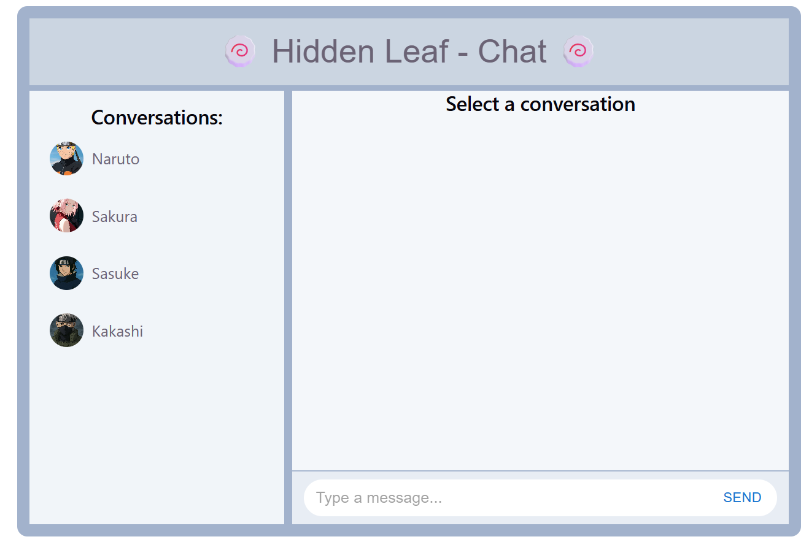
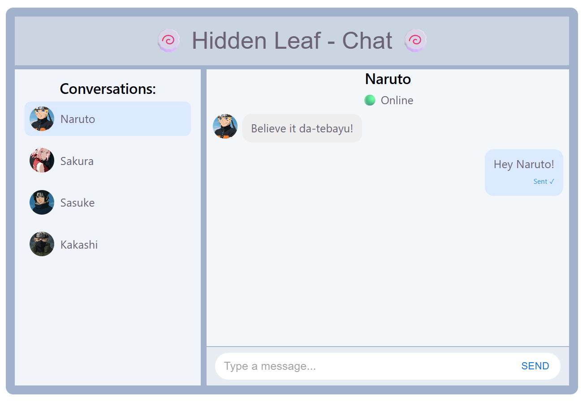
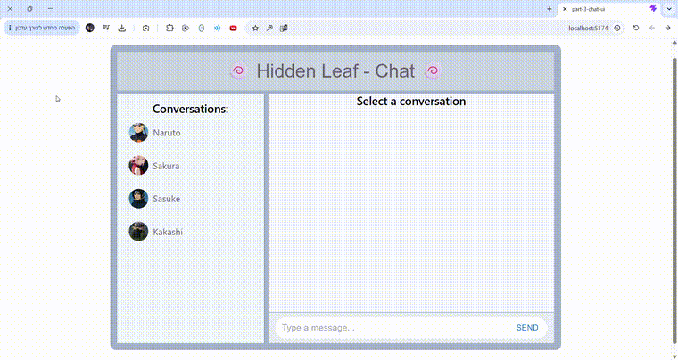

<div align="center">

# 🍥 React Chat UI 🥷

### 💬 A Naruto-inspired chat interface built with React, TypeScript, Redux Toolkit & Material UI.

*A playful frontend project focused on interactive messaging, component-based design, and predictable state management.* ✨


</div>

---


> **🥷 Mini Project | Frontend Development**  
> A Naruto-inspired interactive chat UI built with React, TypeScript, Redux Toolkit and Material UI.

## 🌿 About the Project

**React Chat UI** is a Naruto-inspired messaging interface set in the Hidden Leaf Village. 🏯 Choose a character, explore conversations, and send messages through a clean, interactive layout.

The project was built to practice **⚛️ React + TypeScript**, **🧠 Redux Toolkit for global state management**, and **🎨 Material UI for reusable interface components**.

> **📝 Note:** This is a frontend demonstration with predefined conversations and simulated message delivery. It does **not** include a backend, real-time messaging, authentication, or persistent storage. Messages are kept in Redux state while the app is running.

## 📸 Screenshots

<div align="center">

**🏯 Welcome Screen**



<br/><br/>

**💬 Active Conversation**



</div>

## 🎬 Demo

<div align="center">



*🥷 Switch between characters, send messages, and watch the UI update.*

</div>

## ✨ Features

- 🥷 **Character conversations** — Switch between Naruto, Sakura, Sasuke, and Kakashi.
- 💬 **Interactive messaging** — Compose and send messages in the selected conversation.
- 🎨 **Distinct message bubbles** — Incoming and outgoing messages appear on opposite sides.
- 🟢 **Online/offline indicators** — See each character's simulated availability.
- 📤 **Delivery status simulation** — Messages move from `Sending...` to `Sent ✓` or `Failed ❌` after a short delay, depending on the character's online status.
- 🧠 **Centralized state** — Redux Toolkit manages conversations, selection, and message updates.
- 🔄 **Conversation switching** — Each conversation maintains its messages in app state while navigating between chats.
- 📜 **Automatic scrolling** — The message area scrolls toward the latest message.
- 🧩 **Reusable components** — A modular UI built with React and Material UI.

## 🛠️ Tech Stack

| Technology | Purpose |
| --- | --- |
| ⚛️ **React** | Component-based user interface |
| 🔷 **TypeScript** | Static typing and clearer data models |
| 🧠 **Redux Toolkit** | Global chat state and reducer actions |
| 🔗 **React Redux** | Connecting React components to the store |
| 🎨 **Material UI (MUI)** | UI components and styling |
| ⚡ **Vite** | Development server and production builds |
| 🔍 **ESLint** | Code linting |

## 🧠 How State Management Works

The chat data is managed in a Redux Toolkit slice (`src/store/chatSlice.ts`). The slice tracks the available conversations and the currently selected conversation.

```text
🥷 User selects a character
          ↓
🎯 selectConversationAction
          ↓
🧠 Redux store updates selectedConversationId
          ↓
💬 React components display the selected chat
          ↓
⌨️ User sends a message
          ↓
📤 sendMessageAction → status: "sending"
          ↓
⏳ Simulated delivery delay (1.5 seconds)
          ↓
🔄 changeMessageStatusAction
          ↓
✅ "sent" (online) or ❌ "failed" (offline)
```

This flow demonstrates how Redux actions update shared application state and trigger UI updates. ✨

## 📁 Project Structure

```text
📁 React-Chat-UI/
├── 📂 public/                 # Public icons and static files
├── 📂 docs/
│   └── 📂 images/             # README screenshots and demo
├── 📂 src/
│   ├── 📂 assets/
│   │   └── 📂 avatars/        # Character avatars
│   ├── 📂 components/
│   │   ├── ChatHeader.tsx
│   │   ├── ConversationList.tsx
│   │   ├── MessageComposer.tsx
│   │   └── MessageList.tsx
│   ├── 📂 store/
│   │   ├── chatSlice.ts       # Chat state, actions, reducers
│   │   └── store.ts           # Redux store configuration
│   ├── 📂 types/
│   │   └── chatType.ts        # Conversation and message types
│   ├── App.tsx
│   └── main.tsx
├── 📦 package.json
└── ⚡ vite.config.ts
```

## 🚀 Getting Started

### 📋 Prerequisites

- 🟢 [Node.js](https://nodejs.org/) and npm installed

### 📥 Installation

**1. 📂 Clone the repository**

```bash
git clone https://github.com/ElyasafCohen100/React-Chat-UI.git
cd React-Chat-UI
```

**2. 📦 Install dependencies**

```bash
npm install
```

**3. ▶️ Start the development server**

```bash
npm run dev
```

🌐 Open the local URL shown in your terminal (usually `http://localhost:5173/`).

> **💡 Windows PowerShell tip:** If PowerShell blocks `npm.ps1`, use `npm.cmd install` and `npm.cmd run dev` instead.

### ⚙️ Additional Commands

```bash
npm run build    # 🏗️ Type-check and build for production
npm run preview  # 👀 Preview the production build locally
npm run lint     # 🔍 Run ESLint
```

## 🎯 Learning Goals

This project is a hands-on exercise in:

- ⚛️ Building a multi-component React interface
- 🧠 Managing shared state with Redux Toolkit
- 🔷 Using TypeScript types for chat data
- 🖱️ Handling user interactions and conditional rendering
- ⏳ Simulating asynchronous UI state transitions
- 🧩 Organizing a frontend project into maintainable modules

---

## 👋 Created with Good Vibes By 🎉

<p align="center">
  <a href="https://github.com/ElyasafCohen100">
    
  </a>
</p>

<p align="center">
  <a href="https://github.com/ElyasafCohen100">
    
  </a>
</p>

---

<div align="center">

### 🍥 Built with React, Redux & a little Hidden Leaf spirit! 🍃

**⭐ If you enjoyed exploring the project, consider giving it a star! ⭐**

🥷 *Believe it! Dattebayo!* 🔥

</div>
